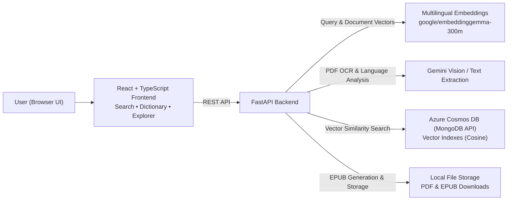

# NoorSearch

**NoorSearch** is a bilingual (English & Arabic) semantic search engine and digital library explorer built for classical Islamic texts, Arabic lexical research, and personal scholarly PDFs. Rather than relying on exact keyword matches, NoorSearch understands conceptual meaning across languages—allowing users to search in English or Arabic and retrieve relevant passages even across language boundaries.

---

## Why NoorSearch?

Searching classical Islamic literature often breaks down with traditional keyword search:
- English translations use varied phrasing for the same concept (e.g., *patience*, *steadfastness*, *perseverance*, *sabr*).
- Some texts or references exist primarily in Arabic while the user queries in English (or vice versa).
- Personal study books and scanned PDFs are rarely searchable alongside canonical collections, and scanned Arabic/bilingual PDFs often have poor OCR.

NoorSearch solves these challenges by combining multilingual dense vector embeddings, cross-lingual retrieval logic, root-based dictionary exploration, and AI-assisted PDF digitization into a unified web application.

---

## Core Capabilities

### 1. Bilingual & Cross-Lingual Semantic Search
- **Natural-Language Understanding**: Uses multilingual embeddings (`google/embeddinggemma-300m`, 768-dimensional vectors) to match concepts and meaning rather than exact strings.
- **Cross-Lingual Retrieval**:
  - Query in **English** to find matching English translations *and* Arabic-only passages.
  - Query in **Arabic** to find matching Arabic passages *and* English-only texts.
- **Collection Filtering & Result Tabs**: Filter searches across specific books or collection groups, and inspect results with Arabic/English side-by-side text, metadata (Surah/Ayah, narrator, hadith number, chapter), and relevance scores.

### 2. Curated Classical Library (12 Collections)
NoorSearch indexes over **45,000 searchable passages** across:
- **Quran** — Full Quranic text with Surah and Ayah metadata
- **Kutub Al-Sitta** — *Sahih al-Bukhari*, *Sahih Muslim*, *Sunan Abu Dawud*, *Jami At-Tirmidhi*, *Sunan an-Nasai*, and *Sunan Ibn Majah*
- **Additional Hadith Collections** — *Muwatta Malik*, *Forty Hadith of an-Nawawi*, *Forty Hadith Qudsi*, and *Forty Hadith of Shah Waliullah Dehlawi*
- **Hans-Wehr Dictionary** — Searchable Arabic-English lexicon

### 3. Hans-Wehr Dictionary & Root Explorer
- Dedicated dictionary lookup page for searching Arabic roots (e.g., *k-t-b*) or English meanings.
- Groups derived forms and meanings around their underlying Arabic root entry.

### 4. Custom Book Explorer & PDF Digitization
Upload personal scholarly PDFs (digital or scanned) into a private searchable library:
- **AI-Powered Verbatim Digitization**: Processes scanned or text PDFs page-by-page using vision-capable Gemini Flash Lite extraction, preserving original formatting without summarizing or translating.
- **Granular Language Detection**: Computes per-page and book-level language distributions (e.g., Arabic/English split percentages) and identifies bilingual vs. monolingual editions.
- **Overlapping Boundary Embeddings**: Embeds each page with surrounding context from adjacent pages so concepts spanning page breaks remain searchable.
- **Proportional Language Boosting**: Vector search results in custom books subtly boost passages whose language composition matches the query language.
- **Built-in Reader & EPUB Export**: Read digitized books page-by-page with customizable font size, typeface, and reading themes, or download the original PDF and a freshly generated **EPUB 2.0** version.

---

## High-Level Architecture

---

## Technology Stack

| Layer | Technology |
|---|---|
| **Frontend** | React, TypeScript, Tailwind CSS, Framer Motion, Lucide Icons |
| **Backend API** | Python, FastAPI, Pydantic, Uvicorn |
| **Embeddings** | SentenceTransformers (`google/embeddinggemma-300m`, 768-dim) |
| **PDF Digitization & OCR** | PyPDF + Gemini Flash Lite |
| **Database & Vector Search** | Azure Cosmos DB for MongoDB (vCore) with IVF cosine vector indexes |
| **Containerization** | Docker & Docker Compose (CPU-optimized Python slim container) |

---

## Application Views

1. **Search (`/`)** — Semantic search bar with hierarchical book/category filtering, result grouping tabs, and bilingual passage cards.
2. **Dictionary (`/dictionary`)** — Focused Hans-Wehr Arabic-English root and word lookup.
3. **Explorer (`/explorer`)** — Custom PDF upload manager with live digitization progress, scope-switchable semantic search (global library or single book), interactive page reader, and PDF/EPUB export.
